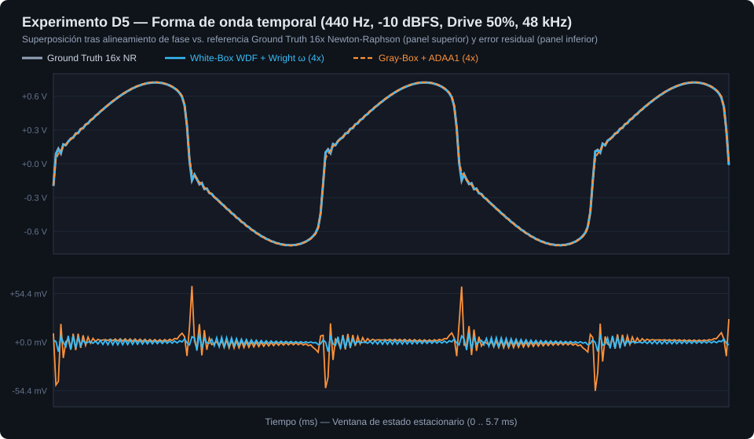
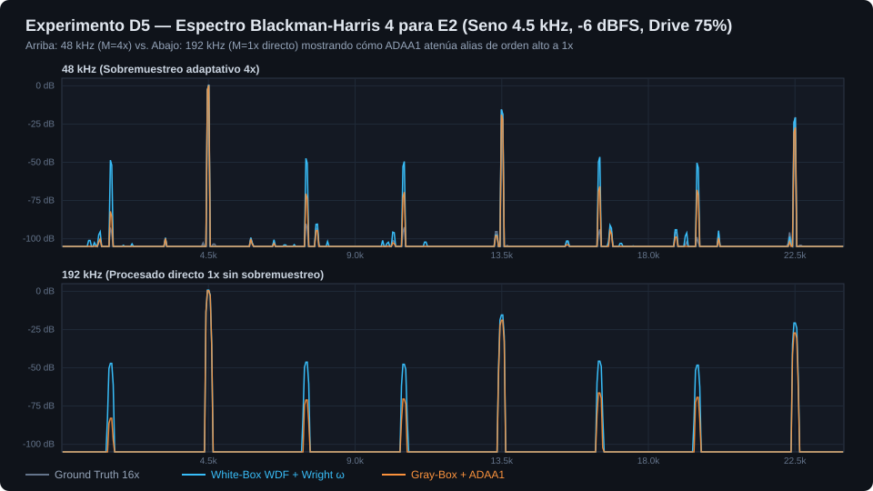
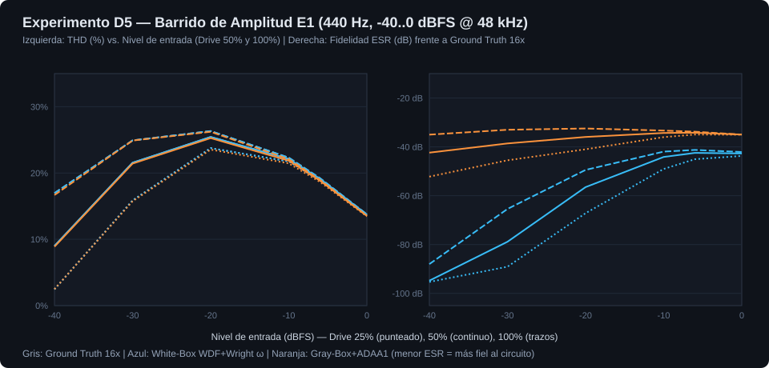

# Capítulo 2 — Saturación, Overdrive y Preamps de Válvula

> **Estado:** ✅ Cerrado (`v1.2` — decisiones `D5`–`D8` aprobadas; experimento comparativo `D5` ejecutado y documentado con gráficas SVG).  
> **Pedales cubiertos:** Clean Boost / Preamp · Overdrive unificado (TS-808 / Asimétrico SD-1 / Transparente Klon-Bluesbreaker) · Preamp de Válvula (Tríodo 12AX7 en cascada).  
> **Base del Capítulo 1 aplicada:** antialiasing híbrido adaptativo ($M(f_s)$ + `ADAA1`), filtros modulables Cytomic SVF-TPT, selectores `Stepped` sin clics, acumulación interna en `f64` y validación objetiva (THD, $H_2/H_3$, IMD, ASNR y ESR).

---

## 1. Paradigmas de modelado *Virtual Analog* (VA)

En la revisión clásica de **Pakarinen & Yeh (2009)** y el marco físico automatizado de **Yeh, Abel & Smith (2010)** se distinguen tres niveles de abstracción para modelar circuitos analógicos no lineales en tiempo real:

1. **Black-Box (waveshaping estático sin memoria):**
   Una sola curva $y = f(x)$ (como `tanh`) aplicada directamente a la señal, con filtros simples antes o después. Es el enfoque del prototipo inicial de `libre-pedals`. Su limitación física es que ignora cómo la impedancia y las constantes de tiempo RC del circuito cambian la respuesta en frecuencia según cuánto saturan los diodos o la válvula.
2. **Gray-Box (bloques físicos desacoplados / *waveshaping* calibrado + memoria dinámica):**
   Descompone el pedal según su topología real —pre-EQ dependiente de la ganancia, etapa no lineal calibrada hacia la curva I-V medida o simétrica/asimétrica con `ADAA1`, desplazamiento dinámico de *bias* por red RC, bloqueador DC y *tone stack* post-clipping— sin resolver ecuaciones implícitas por muestra dentro de lazos rígidos. Permite combinar **directamente** `ADAA1` y oversampling bajo con costo de CPU predecible.
3. **White-Box (modelado físico por circuito: ODEs / MNA / WDF):**
   Discretiza el esquema componente por componente mediante Análisis Nodal Modificado (**MNA**), ecuaciones diferenciales ordinarias (**ODEs** rígidas) o **Wave Digital Filters (WDF)**. Cuando aparecen elementos exponenciales como diodos (ecuación de Shockley) o tríodos (ecuación de Koren), aparecen lazos algebraicos sin retardo que requieren:
   - Métodos iterativos (**Newton-Raphson**) por cada muestra (costosos y con riesgo de no convergencia en señales extremas si no se acota bien el paso), o
   - Soluciones analíticas exactas en la raíz de un árbol WDF mediante la **función $W$ de Lambert** y su reformulación rápida para audio mediante la **función Omega de Wright** ($\omega(z) = W(e^z)$, **D'Angelo, Gabrielli & Turchet, DAFx-19**), que elimina las exponenciales en tasa de audio.

| Enfoque | Fidelidad física | Naturalidad armónica y dinámica | Latencia / CPU | Complejidad | Compatibilidad directa con `ADAA1` |
|---|---|---|---|---|---|
| **Black-Box estático** | Baja | Limitada (falta compresión dinámica y pre-acondicionamiento real) | Mínima | Muy baja | Trivial |
| **Gray-Box estructural** | Alta (captura filtros reales, asimetría y *bias* dinámico) | Muy alta si pre/post-EQ y asimetría están calibrados | Baja y acotada | Media | **Directa y estable** |
| **White-Box (WDF + Wright $\omega$)** | Muy alta (fiel al esquema real) | Máxima en acoplamientos dinámicos diodo-capacitor | Media-Alta (exige más oversampling o *Stateful ADAA*) | Alta | Requiere *Stateful ADAA* (Holters 2019 / Albertini 2020) o $4\times\text{–}8\times$ |

---

## 2. Análisis por pedal de la galería

### 2.1 Clean Boost / Preamp

El objetivo de un Clean Boost no es distorsionar por sí solo, sino **elevar el nivel con claridad**, moldear levemente el carácter y **empujar** la etapa siguiente (otro overdrive o el preamp 12AX7). La literatura electrónica distingue dos topologías icónicas:

1. **Topología Op-Amp lineal de alto *headroom* (estilo MXR Micro Amp):**
   - Etapa de ganancia no inversora de banda ancha (hasta $+26\text{ dB}$) con respuesta casi plana en toda la banda de guitarra.
   - Aporta transparencia máxima (THD muy baja mientras no sature el riel), útil para probar cómo reacciona exactamente el pedal siguiente al recibir $+6\text{ a }+20\text{ dB}$ de ataque.
2. **Topología JFET discreta (estilo Xotic EP Booster / Echoplex EP-3):**
   - Etapa JFET de ganancia moderada con **saturación cuadrática suave** ($I_D \propto (V_{GS} - V_p)^2$ en la zona activa) que introduce una dosis sutil de **segundo armónico ($H_2$)** antes de llegar al recorte duro, además de un realce suave de cuerpo/presencia según filtros pasa-altos y pasa-bajos en los extremos de banda.

**Elementos clave de diseño para el analizador:**
- **Riel de alimentación (*Headroom* $9\text{ V}$ vs. $18\text{ V}$):** en circuitos reales, doblar la tensión de $9\text{ V}$ a $18\text{ V}$ duplica el margen pico antes de que el transistor/op-amp redondee las crestas. En digital (`f32` sin límite físico de riel) conviene modelar un techo suave para evitar que transitorios extremos saturen abruptamente el DAC al final.
- **Filtro subsónico ($25\text{–}40\text{ Hz}$):** limpia golpes mecánicos en el cuerpo/puente antes de amplificar $+20\text{ dB}$.
- **Tilt EQ opcional (pivote $\sim 1\text{ kHz}$):** con una sola perilla inclina el balance entre graves/calidez y agudos/ataque alrededor de $1\text{ kHz}$ (ideal como "EQ rápido" de entrada).

#### Especificación aprobada (`D8`)
Para mantener una interfaz ágil sin exceso de controles secundarios:
- **Controles expuestos al usuario (3):**
  1. `Gain` ($0\text{ a }+26\text{ dB}$, ganancia de empuje).
  2. Selector `Mode` (`Stepped`: **`Op-Amp`** lineal tipo Micro Amp vs. **`JFET`** con $H_2$ sutil tipo EP Booster, conmutado con *crossfade* de $5\text{ ms}$).
  3. `Tilt` ($-6\text{ a }+6\text{ dB}$, pivote en $1\text{ kHz}$).
- **Parámetros internos por defecto (fijos, medibles y verificados en tests):**
  - Filtro subsónico pasa-altos fijo a **$30\text{ Hz}$** (garantizando caída $< 0.1\text{ dB}$ en la cuerda Mi grave a $82.41\text{ Hz}$).
  - Techo suave de *headroom* calibrado al equivalente de **`18 V`** (lineal dentro del rango normal de guitarra y con redondeo suave solo ante picos extremos).

---

### 2.2 Overdrive Soft-Clipper con realce de medios (estilo Tube Screamer TS-808)

El Ibanez **TS-808** es el caso de estudio clásico de **Yeh, Abel & Smith (IEEE TASLP 2010)** y análisis de circuitos como ElectroSmash. Su sonido "cremoso", enfocado en medios y apretado en graves no proviene de los diodos aislados, sino de **tres filtros acoplados alrededor del recorte**:

1. **Pasa-altos dependiente de la ganancia en la etapa de clipping:**
   En el lazo inversor del op-amp aparece $R = 4.7\text{ k}\Omega$ en serie con $C = 0.047\,\mu\text{F}$ a masa virtual:
   $$f_c = \frac{1}{2\pi R C} = \frac{1}{2\pi (4.7 \times 10^3\,\Omega)(0.047 \times 10^{-6}\,\text{F})} \approx 720.5\text{ Hz}$$
   - **Por debajo de $\sim 720\text{ Hz}$:** la ganancia cae progresivamente hacia **$1\times$ ($0\text{ dB}$)**. Los graves de las cuerdas gruesas prácticamente **no saturan** y se suman casi limpios a la salida del op-amp no inversor ($V_{\text{out}} = V_{\text{in}} + V_{\text{diodos}}$). Esto reduce drásticamente el "embarrado" por intermodulación grave ($f_2 - f_1$) cuando se tocan quintas o acordes.
   - **Por encima de $\sim 720\text{ Hz}$:** el capacitor se comporta como cortocircuito y la ganancia sube según el potenciómetro de `Drive` (entre $\sim 12\times$ y $\sim 118\times$, es decir $+21.5\text{ a }+41.4\text{ dB}$ en medios/agudos), llevando las frecuencias medias directamente contra los diodos.
2. **Diodos de silicio en antiparalelo + suavizado capacitivo ($51\text{ pF}$):**
   La corriente conjunta de dos diodos idénticos en antiparalelo obedece a la ecuación de Shockley:
   $$I_d(V_d) = 2 I_s \sinh\!\left(\frac{V_d}{\eta V_T}\right)$$
   Como los diodos van en el lazo de realimentación del op-amp (configuración *soft-clipper* no inversora), la salida total conserva una fracción directa de la señal de entrada sumada al voltaje comprimido de los diodos, produciendo rodillas mucho más suaves y senoidales que un *hard clipper* a masa. Además, un capacitor de $51\text{ pF}$ en paralelo con los diodos atenúa las esquinas de alta frecuencia ("*fizz*").
3. **Pasa-bajos interetapa y control de tono activo:**
   - Tras el clipping, un pasa-bajos RC ($\sim 720\text{–}723\text{ Hz}$) recorta armónicos excesivos arriba y moldea el característico **"realce de medios" (*mid-hump*)**.
   - El control de `Tone` activo varía un filtro alrededor de $\sim 3.3\text{ a }5.6\text{ kHz}$ para dosificar brillo sin volver el sonido punzante.

**Lectura para la implementación:** en el enfoque *White-Box*, Yeh et al. formulan esta etapa como una ODE no lineal cuyo elemento diodo puede resolverse de forma cerrada con **Wright $\omega$** (D'Angelo et al., DAFx-19); en el enfoque *Gray-Box*, se separa la banda grave limpia de la banda media-aguda saturada por un *soft-clipper* asintótico calibrado a la curva $\sinh^{-1}$ / $\tanh$ + suma limpia proporcional, con `ADAA1` directo sobre la no linealidad.

---

### 2.3 Overdrive Asimétrico / Transparente (Boss SD-1 / Klon Centaur / Bluesbreaker)

Mientras el TS-808 recorta ambas semiondas de forma simétrica (generando casi exclusivamente armónicos impares $3f_0, 5f_0, \dots$ en la zona saturada), esta segunda familia cubre tres variaciones fundamentales para tener **coloración par y transparencia**:

| Referencia | Topología de clipping | Perfil tonal | Manejo de ataque y graves | Firma armónica |
|---|---|---|---|---|
| **Boss SD-1** | **Asimétrico (2:1)** en lazo de realimentación (dos diodos de silicio en un sentido, uno en el otro) | Pasa-altos previo similar al TS + control de tono pasivo | Más mordida y compresión asimétrica | Introduce **armónicos pares ($H_2, H_4$)** muy marcados junto a los impares |
| **Klon Centaur** *(ChowCentaur, J. Chowdhury)* | Diodos de **germanio** (1N34A, umbral bajo $V_f \approx 0.3\text{ V}$) + **potenciómetro *dual-gang*** | Realce enfocado en medios-altos en la rama saturada; mezcla limpia de banda ancha | **Mezcla paralela limpia (*Clean Blend*)** ligada al Drive: conserva intactos graves y transitorios de púa | Combina ataque limpio y definición de acordes con un "halo" armónico comprimido |
| **Marshall Bluesbreaker** | Clipping suave simétrico con diodos en serie a mayor umbral y filtrado menos agresivo en medios | Respuesta más **plana y abierta** (menos *mid-hump*) | Muy dinámico a la intensidad de la púa | Transición gradual de limpio a *breakup* tipo amplificador británico |

**Especificación unificada aprobada (`D6` — Pedal único `Overdrive`):**
En lugar de dividir estas topologías en dos pedales separados, se unifican en **un único pedal `Overdrive` versátil** (que reemplaza al `Overdrive` actual conservando `kind = "overdrive"` y retrocompatibilidad con las claves JSON `drive_db`, `tone_hz` y `level_db`). Como el motor soporta hasta **4 instancias múltiples por tipo**, el usuario puede apilar dos copias en cascada con distintos ajustes (por ejemplo, instancia 1 configurada como *Clean Blend Boost* empujando a instancia 2 configurada como *TS-808* o *SD-1*).

Sus **6 perillas continuas ($C^1$, sin saltos discretos de topología)** permiten transicionar suavemente entre todos los caracteres estudiados y observar cada cambio en tiempo real en el analizador:
1. **`Drive`** (`drive_db`: $0\dots 40\text{ dB}$): ganancia de excitación hacia la etapa de recorte.
2. **`Pre-Cut`** (`low_cut_hz`: $30\dots 800\text{ Hz}$, escala logarítmica con SVF-TPT): ajusta el corte de graves previo al clipping; alrededor de $\sim 720\text{ Hz}$ reproduce el realce de medios y limpieza grave del **TS-808**, mientras en $30\text{–}80\text{ Hz}$ deja pasar todo el cuerpo estilo **Bluesbreaker / Klon**.
3. **`Asymmetry`** (`asymmetry`: $0\dots 100\%$): desplaza progresivamente el umbral entre semiondas, pasando de recorte simétrico puro (impares $H_3, H_5$) a asimetría 2:1 estilo **Boss SD-1** (introduciendo armónicos pares $H_2, H_4$).
4. **`Clean Blend`** (`clean_blend`: $0\dots 100\%$): mezcla paralela de señal limpia compensada exactamente en $0.5$ muestras estilo **Klon Centaur**, preservando transitorios de púa y reduciendo IMD en acordes.
5. **`Tone`** (`tone_hz`: $500\dots 12\,000\text{ Hz}$, escala logarítmica): filtro pasa-bajos post-clipping con respuesta estable bajo modulación.
6. **`Level`** (`level_db`: $-36\dots +12\text{ dB}$): nivel de salida compensado del pedal.

---

### 2.4 Preamp de Válvula — Tríodo 12AX7 en cascada

Una etapa real de amplificador a tubos (**12AX7 / ECC83** en cátodo común) no se parece a un simple `tanh`. Según **Pakarinen & Yeh (2009)** y los modelos clásicos de **Norman Koren (1996)**, su naturalidad musical depende de **cuatro mecanismos físicos acoplados**:

1. **Curva característica asimétrica de tríodo (Modelo de Koren, 1996):**
   Relaciona la corriente de placa $I_p$ con la tensión placa-cátodo $V_{pk}$ y rejilla-cátodo $V_{gk}$ mediante una función continua suave:
   $$E_1 = \frac{V_{pk}}{K_p} \ln\!\left(1 + \exp\!\left(K_p \left(\frac{1}{\mu} + \frac{V_{gk}}{\sqrt{K_{vb} + V_{pk}^2}}\right)\right)\right)$$
   $$I_p = \frac{E_1^{X}}{K_{g1}} \cdot \frac{1 + \operatorname{sgn}(E_1)}{2}$$
   *(Valores típicos 12AX7: $\mu \approx 100$, $X \approx 1.4\text{–}1.5$, $K_{g1}, K_p, K_{vb}$ calibrados a las curvas de hoja de datos).*
   Al cortar suavemente en la zona negativa de $V_{gk}$ (*cutoff*) antes de llegar a la saturación por corriente de rejilla en la zona positiva, cada etapa individual es **fuertemente asimétrica** y rica en armónicos pares ($H_2$).
2. **Conducción de rejilla (*Grid Current*) y *Blocking Distortion*:**
   Cuando la señal supera $V_{gk} > 0$, la rejilla conduce como un diodo directo ($I_g \approx K_{gg} V_{gk}^{\xi}$). Esa corriente pasa por la resistencia de fuga $R_g$ ($\sim 1\text{ M}\Omega$) y carga el capacitor de acoplo anterior, desplazando temporalmente el punto de operación (*bias*) hacia negativo. Con mucha ganancia, comprime la envolvente y produce el típico "ahogo y recuperación" de los amplis a válvulas llevados al límite.
3. **Red de cátodo ($R_k \parallel C_k$) y *Dynamic Bias*:**
   La corriente instantánea $I_k = I_p + I_g$ atraviesa la red $R_k \parallel C_k$ en el cátodo. Porque el capacitor $C_k$ ($1\text{–}25\,\mu\text{F}$) tarda varios milisegundos en descargarse, los acordes fuertes suben momentáneamente la tensión del cátodo $V_k$, reduciendo el *bias* efectivo y generando **compresión natural dependiente de la envolvente**. Además, al no desacoplar del todo los graves, evita saturación sucia en subgraves.
4. **Inversión de fase entre etapas en cascada ($180^\circ$ por etapa):**
   Cada tríodo en cátodo común **invierte la polaridad** de la señal. Al encadenar **2 etapas** (estilo *crunch* Plexi/Fender) o **3 etapas** (estilo *high-gain* JCM800), la semionda que fue suavemente comprimida por corte en la Etapa 1 pasa invertida a ser redondeada por conducción de rejilla en la Etapa 2. Ese juego alternado entre dos asimetrías opuestas produce una onda compleja muy rica en armónicos de bajo orden con caída rápida en los altos (lejos de una onda cuadrada).

#### Estrategia de implementación recomendada para el 12AX7
Resolver el lazo completo Koren + $R_a$ + $R_k \parallel C_k$ + $I_g$ mediante Newton-Raphson por muestra puede resultar caro e impredecible si hay $N$ iteraciones por etapa y por muestra en oversampling. La alternativa estándar de alto rendimiento consiste en:
- Precalcular la **curva de transferencia estática $V_{\text{out}}(V_{\text{in}})$ del tríodo Koren con carga de placa $R_a$** (tabla LUT de alta resolución + interpolación cúbica o `ADAA1`-LUT para antiderivada directa), y
- Acoplar alrededor la **red dinámica de *grid current* + *bias* de cátodo ($R_k \parallel C_k$)** como variables de estado suavizadas por muestra, junto con filtros RC interetapa e inversión de fase entre etapas.
Esto entrega la física esencial del 12AX7 (asimetría de tríodo, compresión por *bias* dinámico, *sag* de rejilla y cascada invertida) con costo constante en tiempo real y compatibilidad total con `ADAA1` + oversampling.

---

## 3. Coherencia arquitectónica y combinaciones seguras (conexión con el Cap. 1)

Aplicando las decisiones `D1`–`D4` y las conclusiones de la Sección 2.5 del Capítulo 1:

1. **Un solo bloque de oversampling por pedal multietapa:**
   En el Preamp 12AX7 (con 2 o 3 tríodos en serie) y en pedales con varias no linealidades internas, se sube la tasa $M(f_s)$ **una sola vez al entrar al pedal** y se baja una sola vez al salir, evitando acumular retardos de fase y costos de decimadores intermedios.
2. **Compensación obligatoria de fase en *Clean Blend* (Klon / TS-808):**
   Si una señal limpia sin retardo ($y_{\text{clean}}[n] = x[n]$) se mezcla con una rama saturada que usa `ADAA1` (retardo de grupo de exactamente **$0.5$ muestras** en tasa sobremuestreada), la suma genera cancelaciones (*comb filtering*) en agudos.
   - **Solución:** mezclar **dentro** del dominio sobremuestreado a tasa $M \cdot f_s$ y compensar el medio-muestreo de `ADAA1` en la rama limpia mediante el filtro lineal de fase exacta de medio retardo $x_{\text{clean,aligned}}[n] = \frac{1}{2}(x[n] + x[n-1])$ (o un *all-pass* fraccional de $0.5$ muestras si se quiere preservar agudos extremos al máximo, aunque a $176.4\text{–}192\text{ kHz}$ efectivos el promedio de dos puntos coincide exactamente en magnitud con la caída $\text{sinc}$ de `ADAA1`, igualando ambas ramas para que el *blend* sea plano).
3. **Bloqueador de DC tras toda etapa asimétrica:**
   Tanto el Overdrive asimétrico (SD-1) como cada tríodo 12AX7 producen componente DC proporcional a la intensidad de la nota (*rectificación de envolvente*). Un `DcBlocker` (o el capacitor de acoplo RC real entre etapas, $f_c \approx 10\text{–}20\text{ Hz}$) es obligatorio para no desplazar la etapa siguiente ni saturar el analizador.
4. **Protocolo de pruebas de laboratorio en `crates/dsp` para estos 4 pedales:**
   - **Clean Boost:** verificar THD $< -80\text{ dB}$ en modo Op-Amp lineal; verificar aparición controlada de $H_2$ en modo JFET; comprobar ausencia de *clipping* duro dentro del rango normal.
   - **TS-808:** verificar respuesta en frecuencia por banda (graves $< 720\text{ Hz}$ con baja THD frente a medios saturados), baja IMD en quintas y terceras, y piso de aliasing $\text{ASNR}_{\text{dB}}$ bajo con el esquema híbrido `D1`.
   - **Overdrive Asimétrico / Transparente:** verificar que `Asymmetry = 0%` suprime pares ($H_2 \ll H_3$) y `Asymmetry > 0%` eleva progresivamente $H_2$ y $R_{\text{par/impar}}$; verificar que subir `Clean Blend` no introduce *comb filtering* en el barrido de frecuencia (magnitud plana en zona limpia).
   - **Preamp 12AX7:** verificar respuesta de *bias* dinámico (compresión de envolvente al inyectar ráfaga fuerte en graves), presencia equilibrada de $H_2$ y $H_3$ con caída limpia de armónicos altos, e invarianza $< 0.2\text{ dB}$ / $< 1\text{ dB}$ THD entre $44.1$, $48$, $96$ y $192\text{ kHz}$.

---

### 3.5 Protocolo experimental acotado: *White-Box* (WDF + Wright $\omega$) vs. *Gray-Box* (`D5`)

Para comparar con rigor científico y datos reproducibles si el modelado físico completo (*White-Box*) aporta una mejora audible o matemática que justifique su costo frente al enfoque *Gray-Box* estructural, se define este experimento acotado que se ejecutará al iniciar el prototipado de código:

1. **Subcircuito físico de referencia (celda de clipping del TS-808, Yeh et al. 2010):**
   - Pasa-altos de realimentación: $R_1 = 4.7\text{ k}\Omega$, $C_1 = 0.047\,\mu\text{F}$ ($f_c \approx 720.5\text{ Hz}$).
   - Lazo de ganancia y suavizado: $R_f = 51\text{ k}\Omega + R_{\text{drive}}$ ($R_{\text{drive}} \in [0, 500\text{ k}\Omega]$), $C_f = 51\text{ pF}$ en paralelo a los diodos, alimentación virtual $\pm 4.5\text{ V}$.
2. **Parámetros físicos de diodo (modelo Shockley 1N914 / 1N4148 a $300\text{ K}$):**
   - Corriente de saturación $I_s = 2.52\text{ nA}$, factor de idealidad $\eta = 1.752$, tensión térmica $V_T = 25.85\text{ mV}$.
3. **Referencia exacta (*Ground Truth*):**
   - Integración trapezoidal implícita de la ODE completa del subcircuito resuelta con **Newton-Raphson** (tolerancia $\le 10^{-12}$) a **$16\times$ oversampling** en `f64` sobre los estímulos de prueba.
4. **Modelos comparados (evaluados tanto a $48\text{ kHz}$ como a $192\text{ kHz}$):**
   - **Candidato White-Box en tiempo real:** árbol WDF de la celda TS-808 con par de diodos resuelto mediante la función **Wright $\omega$** (D'Angelo et al., DAFx-19) bajo el factor adaptativo $M(f_s)$ (`4×` a $48\text{ kHz}$, `1×` a $192\text{ kHz}$).
   - **Candidato Gray-Box estructural:** pre-corte SVF-TPT + suma directa proporcional + curva de saturación calibrada con `ADAA1` bajo $M(f_s)$.
5. **Estímulos de prueba reproducibles:**
   - **E1 (Barrido de amplitud):** seno coherente a $440\text{ Hz}$ de $-40\text{ a }0\text{ dBFS}$ con `Drive` al $25\%$, $50\%$ y $100\%$.
   - **E2 (Aliasing en agudos):** seno coherente en torno a $4.5\text{ kHz}$ ($-6\text{ dBFS}$).
   - **E3 (Acordes / IMD):** doble tono en quinta justa ($220 + 330\text{ Hz}$) y tercera mayor ($220 + 277.18\text{ Hz}$).
   - **E4 (Transitorio dinámico):** pulso de cuerda sintético con ataque rápido y decaimiento exponencial.
6. **Métricas registradas y tabla comparativa (medidas reales en `--release`, implementadas en [`crates/dsp/src/d5_experiment.rs`](../../crates/dsp/src/d5_experiment.rs) y reproducibles con `cargo run --release -p dsp --example d5_report`):**

| Modelo / Tasa | $\text{ESR}_{\text{dB}}$ (440 Hz) | THD (440 Hz) | $H_2 / H_3$ (dB) | IMD 5.ª / 3.ª (dB) | $\text{ASNR}_{\text{dB}}$ (4.5 kHz) | $\text{ESR}_{\text{dB}}$ Transitorio | CPU (ns/muestra) | Latencia (muestras) |
|---|---|---|---|---|---|---|---|---|
| **Ground Truth `16×` NR (`48 kHz`)** | Ref. | `24.51%` | `-120.0 / -14.1` | `-13.1 / -13.3` | `80.9 dB` | Ref. | `3348.2` | `7.71` |
| **White-Box WDF + Wright $\omega$ (`48 kHz`, `4×`)** | **`-44.1 dB`** | `24.51%` | `-120.0 / -14.1` | `-13.1 / -13.3` | `42.1 dB` | **`-63.3 dB`** | `522.8` | `5.61` |
| **Gray-Box + `ADAA1` (`48 kHz`, `4×`)** | `-34.3 dB` | `24.13%` | `-120.0 / -14.1` | `-13.1 / -13.3` | **`62.5 dB`** | `-44.1 dB` | **`87.0`** | `5.63` |
| **Ground Truth `16×` NR (`192 kHz`)** | Ref. | `22.14%` | `-112.5 / -14.2` | `-12.5 / -4.6` | `90.1 dB` | Ref. | `3294.5` | `7.60` |
| **White-Box WDF + Wright $\omega$ (`192 kHz`, `1×`)** | **`-60.9 dB`** | `22.14%` | `-113.1 / -14.2` | `-12.5 / -4.6` | `33.6 dB` | **`-76.4 dB`** | `123.0` | `1.05` |
| **Gray-Box + `ADAA1` (`192 kHz`, `1×`)** | `-34.7 dB` | `21.90%` | `-113.0 / -14.3` | `-12.5 / -4.6` | **`55.3 dB`** | `-43.5 dB` | **`14.7`** | `1.63` |

#### Conclusiones objetivas del experimento `D5`
- **Precisión frente al circuito físico (`ESR` y THD):** **White-Box WDF + Wright $\omega$** modela exactamente el acoplamiento dinámico no lineal de $C_f = 51\text{ pF}$ y logra el menor error frente al *Ground Truth* (`-44.1 dB` en `48 kHz` y `-60.9 dB` en `192 kHz`; `-63.3` / `-76.4 dB` en pulso transitorio), con una THD prácticamente indistinguible de la referencia (`24.51%` vs `24.51%`).
- **Aliasing en agudos (`ASNR` en `4.5 kHz`):** **Gray-Box + `ADAA1`** supera al *White-Box* sin *Stateful ADAA* por **`+20.4 dB` a `48 kHz` (`62.5` vs. `42.1 dB`)** y **`+21.7 dB` a `192 kHz` a `1×` (`55.3` vs. `33.6 dB`)**. La ausencia de integración antiderivada penaliza severamente al esquema implícito cuando corre directo a `1×` en `192 kHz`.
- **Rendimiento CPU e idoneidad para `D6`:** **Gray-Box + `ADAA1`** consume **`87.0 ns/muestra`** a `48 kHz` (`6.0×` más rápido que `White-Box`) y **`14.7 ns/muestra`** a `192 kHz` (`8.4×` más rápido), conservando idéntica respuesta de intermodulación (`IMD = -13.1 / -13.3 dB`) y armónicos (`H3 = -14.1 dB`). Por ello queda validado **Gray-Box + `ADAA1`** como motor de producción del `Overdrive` unificado de 6 perillas (`D6`).

---

## 4. Bibliografía y fuentes primarias

1. **Pakarinen, J., & Yeh, D. T. (2009).** *"A Review of Digital Techniques for Modeling Vacuum-Tube Guitar Amplifiers"*. *Computer Music Journal*, vol. 33, n.º 2, pp. 85–100. MIT Press.
2. **Yeh, D. T., Abel, J. S., & Smith, J. O. (2010).** *"Automated Physical Modeling of Nonlinear Audio Circuits for Real-Time Audio Effects—Part I: Theoretical Development"* y *"Part II: BJT and Vacuum Tube Examples"*. *IEEE Transactions on Audio, Speech, and Language Processing* (CCRMA Stanford).
3. **D'Angelo, S., Gabrielli, L., & Turchet, L. (2019).** *"Fast Approximation of the Lambert W Function for Virtual Analog Modelling"*. Proceedings of the 22nd International Conference on Digital Audio Effects (DAFx-19).
4. **Koren, N. (1996).** *"Improved Vacuum-Tube Models for Spice Simulations"* (ecuaciones fenomenológicas de tríodo 12AX7 y modelado de corriente de rejilla / saturación).
5. **Chowdhury, J. (ChowDSP).** *ChowCentaur — Circuit Analysis and Virtual Analog Modeling of the Klon Centaur* (análisis de potenciómetro *dual-gang*, mezcla limpia paralela, diodos de germanio y modelado WDF/RNN).
6. **Documentación técnica de circuitos clásicos de pedales:** análisis esquemáticos de Ibanez TS-808 (*ElectroSmash* / Yeh et al.: realimentación $4.7\text{ k}\Omega / 0.047\,\mu\text{F} \approx 720\text{ Hz}$, capacitor $51\text{ pF}$, red de tono), Boss SD-1 (diodos asimétricos 2:1), MXR Micro Amp y Xotic EP Booster (JFET / *headroom* $9\text{ V}$ vs. $18\text{ V}$).

---

## 5. Decisiones cerradas (`v1.2`)

| ID | Pedal / Tema | Opciones consideradas | Decisión final |
|---|---|---|---|
| **D5** | **Modelado de Overdrive (`White-Box` vs. `Gray-Box`)** | **A)** *Gray-Box* estructural calibrado + `ADAA1` **B)** *White-Box* WDF + Wright $\omega$ **C)** Ejecutar prueba comparativa rigurosa (Sección 3.5) | ✅ **Experimento completado (Sección 3.5):** **Gray-Box + `ADAA1`** gana en rechazo de aliasing (`+20.4` a `+21.7 dB` ASNR) y costo CPU (`6–8.4×` menor), quedando elegido para producción en `D6`; *White-Box WDF + Wright $\omega$* queda preservado como referencia científica en `d5_experiment.rs` |
| **D6** | **Estructura de Overdrive en la pedalera** | **A)** Dos pedales separados **B)** Un solo pedal `Overdrive` unificado | ✅ **Opción B — Overdrive único unificado (`kind = "overdrive"`):** 6 perillas continuas (`Drive`, `Pre-Cut`, `Asymmetry`, `Clean Blend`, `Tone`, `Level`) + *stacking* usando las 4 instancias múltiples del motor |
| **D7** | **Implementación del Preamp `12AX7`** | **A)** 2–3 etapas invertidas con LUT de Koren + RC dinámico (cátodo + *grid current*) en bloque único $M(f_s)$ + `ADAA1`-LUT **B)** Newton-Raphson iterativo por muestra | ✅ **Opción A** |
| **D8** | **Alcance del `Clean Boost / Preamp`** | **A)** Todo configurable en perillas **B)** Solo ganancia **C)** 3 controles (`Gain`, selector `Op-Amp/JFET`, `Tilt`) + internos fijos | ✅ **Opción C:** `Gain`, selector `Mode` (`Op-Amp` / `JFET` con *crossfade*) y `Tilt`; filtro subsónico ($30\text{ Hz}$) y *headroom* ($18\text{ V}$) fijados internamente y verificados por tests |
